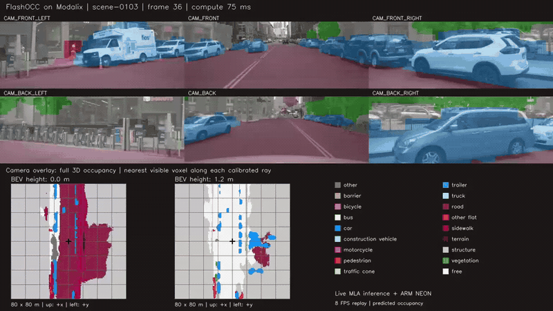
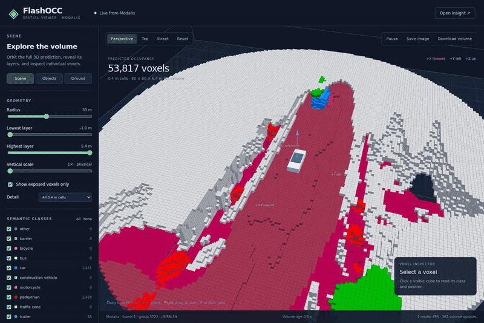

# FlashOCC on Modalix

Six calibrated camera views produce a dense `200 × 200 × 16` semantic occupancy
volume. The C++ app runs the camera and BEV networks on MLA, with ARM NEON pooling,
argmax and occupancy rendering. EV74 camera preprocessing is configurable.
Six RTSP streams feed the [Insight mosaic](app/INSIGHT.md); the
[host 3D viewer](viewer/README.md) displays interactive semantic voxels.

## Demo clips

**Insight — six camera overlays and BEV occupancy slices (10 seconds).**
Click the animated preview to open the MP4.

[](docs/media/insight.mp4)

**Host 3D grid — live semantic voxels with an orbiting view (10 seconds).**
The viewer uses physical height scale and 0.4 m cells.

[](docs/media/host-3d-grid.mp4)

**15-second Full HD MP4s (1920×1080):**
[Insight](docs/media/hd-15s/insight.mp4) ·
[Host 3D grid with camera orbit](docs/media/hd-15s/host-3d-grid.mp4).

Both recordings use QAT models with EV74 preprocessing on Modalix and replay
`scene-0103` at 8 FPS. The host receives occupancy snapshots at 2 Hz; browser
rendering speed is separate from application throughput.
[Recording details and reproduction](docs/media/README.md).

## Validated comparison

The preserved 2026-10-27 test uses the same 32 labeled inputs and Occ3D camera
visibility masks for each model pair. Accuracy is model-level evaluation of
normalized inputs, excluding RTSP compression and EV74 image normalization.

| Model pair | Camera-masked mIoU | Masked voxel accuracy |
| --- | ---: | ---: |
| Original FP32 | 34.58% | 89.34% |
| Original BF16-heavy | 34.65% | 89.36% |
| BF16 camera + small mixed BEV | 33.57% | 89.22% |
| QAT camera + QAT BEV | 31.87% | 86.00% |

Full-app performance uses six 12 FPS RTSP streams, overlays, 2 Hz snapshots and
an explicitly disabled logit validity scan. Every output processes all six views.

| Networks / image preprocessing | Mean app processing | App FPS |
| --- | ---: | ---: |
| Previous mixed / ARM | 223.1 ms | 4.48 |
| Previous mixed / EV74 | 153.3 ms | 6.50 |
| QAT / ARM | 198.4 ms | 5.03 |
| QAT / EV74 | 119.9 ms | 8.31 |

QAT + EV74 is the fastest measured route; among the compiled pairs compared
here, the original BF16-heavy pair has the highest measured accuracy. Choose a model pair according
to the application requirement. These are subset results, not a full nuScenes
validation benchmark. [Detailed timings and scope](app/QAT_COMPARISON.md) ·
[Frozen evidence and reproducibility contract](benchmarks/flashocc_20261027/README.md).

[Cleanup audit and independent reproduction](reports/cleanup/README.md).

## Setup

The repository includes a [ready-to-run demo](demo/README.md): QAT camera and
compatible QAT BEV archives, six 20 FPS clips, matching geometry, and the tested
ARM64 executable (approximately 150 MiB). A clone contains these application
assets. Modalix, compatible Neat runtime/plugins and Insight are still required.
No model compilation or submodule checkout is needed for this demo.

Inside the SDK container:

```bash
git clone https://github.com/ashish-negi-sima-ai/flashocc-modalix.git
cd flashocc-modalix
python3 scripts/verify_demo.py

export FLASHOCC_DEVICE=sima@10.42.0.102
export FLASHOCC_INSIGHT_API=https://10.42.0.1:9900
neat --json
```

Replace the device and SDK host addresses for your network. You can also copy
`configs/runtime.example.json` to `configs/runtime.local.json` and set `device`
and `insight_api` there. CLI arguments override environment/local defaults.
The SDK and Modalix must see the shared repository at the same absolute path;
its folder name and location within that workspace can vary. Geometry and
model paths in the bundled launch configuration are relative.

For export/training work, initialize the pinned upstream FlashOCC submodule
with `git submodule update --init --recursive` and use the SiMa compiler
environment. Runtime identities and demo asset checksums are pinned in
[demo/manifest.json](demo/manifest.json).

## Run the bundled application

Use the published `rtsp.tcp` and `videoUDP` starting ports from `neat --json`:

```bash
python3 scripts/run_insight_demo.py start \
  --rtsp-port 8554 --video-port 9000 --output-dir artifacts/live

tail -f artifacts/live/live.log

python3 scripts/run_insight_demo.py status --output-dir artifacts/live
python3 scripts/run_insight_demo.py stop --output-dir artifacts/live
```

The default selects sequential QAT camera inference, EV74 BGR preprocessing,
QAT BEV, 2 Hz snapshots, rendering off and the logit check off: approximately
**12.1 FPS** in the validated 20 FPS-input test. Each update processes six views.
To display the Insight mosaic, stop and restart with `--visualization true`;
earlier visualization-enabled runs measured approximately **8.3 FPS**. The
helper prints Insight's viewer URL. [Full run commands](demo/README.md).

For interactive 3D, in a host terminal outside Docker:

```bash
python3 scripts/run_host_3d_viewer.py start --source artifacts/live/latest.occ
python3 scripts/run_host_3d_viewer.py stop
```

The service prints its URL; pass `--host` for access from another machine.
WebGL rendering runs in the browser, separately from Modalix inference.

## Optional build and historical comparison assets

Use the SiMa SDK/compiler environment for export/validation and the ARM64 Neat
SDK for application builds. The original comparison used installed Neat 0.5.0;
precompiled model identities are pinned by SHA-256 in [models/manifest.json](models/manifest.json).
The bundled demo contains the selected QAT pair. Other experimental model pairs
and the labeled 32-input comparison fixtures use external asset storage.

Restore the preserved asset bundle obtained from your model storage:

```bash
python3 scripts/comparison_assets.py restore \
  --archive /path/to/flashocc_20261027-assets.tar.gz \
  --asset-root /path/to/restored-assets
python3 scripts/comparison_assets.py verify --asset-root /path/to/restored-assets
```

Keep the adjacent `.tar.gz.json` inventory/checksum file with the bundle.
The local cleanup archive is stored outside the repository under
`/workspace/benchmark-archives/`; a public release download URL has not been
published. This larger bundle is needed for the historical comparison, not for
running the bundled demo.

Inside the SDK container, from the repository root:

```bash
cmake -S app -B build/modalix \
  -DCMAKE_TOOLCHAIN_FILE=toolchain.cmake -DCMAKE_BUILD_TYPE=Release
cmake --build build/modalix -j3

python3 scripts/run_insight_demo.py start \
  --binary build/modalix/flashocc_insight \
  --rtsp-port 8554 --video-port 9000 --output-dir artifacts/live
```

Execution presets use workspace-relative model paths. For an asset bundle
restored elsewhere, use the comparison runner below or generate execution/source
configs with the corresponding absolute asset paths. Preset defaults retain the
logit scan; disable it explicitly when reproducing the FPS table.
[All execution settings](app/EXECUTION.md).

## Reproduce both comparisons

Use a fresh results directory. The asset root may be a separately restored
bundle. `--python` must identify an environment with NumPy and ONNX Runtime.
The device/API values can come from the local runtime configuration.

```bash
python3 scripts/reproduce_comparison.py accuracy \
  --asset-root /path/to/restored-assets \
  --results artifacts/comparison-repeat \
  --python /path/to/validation-environment/bin/python

python3 scripts/reproduce_comparison.py performance \
  --asset-root /path/to/restored-assets \
  --results artifacts/comparison-repeat \
  --browser-python /path/to/playwright-environment/bin/python

python3 scripts/reproduce_comparison.py summarize --results artifacts/comparison-repeat
python3 benchmarks/flashocc_20261027/check.py --records-only
```

Accuracy regenerates original FP32 labels and runs all three compiled model
pairs on the same 32 inputs. Performance runs all four ARM/EV74 configurations
sequentially with 256 groups and 64 warmups. It uses a separate retimestamped
input directory and preserves the reference assets. The output includes raw
records and `comparison-report.json`. The optional Playwright interpreter can
also be set with `FLASHOCC_BROWSER_PYTHON`; it was enabled for the reference
viewer-quality measurements. Timing variations must be reported rather
than overwriting the frozen baseline.

## Development and model preparation

- [Application contracts and replay](app/README.md)
- [Execution and preprocessing settings](app/EXECUTION.md)
- [QAT training and dataset preparation](qat/README.md)
- [Model distribution and identities](models/README.md)
- [Reports and metric definitions](reports/README.md)
- [ARM pooling implementation](cpp/README.md)
- [Experiments and preserved investigations](experiments/README.md)

The deployment boundary remains camera → calibrated ARM pooling → BEV/head →
argmax. Camera order is front-left, front, front-right, back-left, back,
back-right. Model output class 17 is free space. Preserve upstream image
transforms and calibrated geometry; independent photographs are insufficient.
The QAT BEV compatibility copy changes shape metadata only, retaining its ELF.

Run the existing host tests with an appropriate validation environment:

```bash
python3 -m unittest discover -s tests -v
python3 -m unittest viewer.test_server -v
python3 -m unittest discover -s qat/tests -v
```

ARM pooling/raycast/stream tests and device inference must also run on Modalix
when application behavior changes. Historical measurements and compiler/runtime
investigations remain in [docs/experiments](docs/experiments/FLASHOCC_HISTORY.md).
