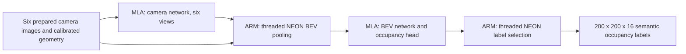

# FlashOCC Modalix replay application

This C++20 application runs the complete M0 inference pipeline on Modalix using
the existing compiled camera and BEV archives and the threaded ARM NEON kernels.
Both models stay loaded and worker threads persist across frames.

For the six-RTSP-stream application and live occupancy visualization, see
[INSIGHT.md](INSIGHT.md).



Neat handles tensor casts, tessellation and transfers with its `AUTO` placement.
The camera archive is BF16; the BEV archive is BF16 with INT8 Softplus. Pooling
and label selection use eight persistent CPU threads by default. Camera views
run sequentially through the same camera runner. See the root README for the
checkpoint, export, calibration and compilation provenance.

## Build and run

From `/workspace/GitHub/occupancy-prediction` on the development host:

```bash
# Existing SDK/toolchain installation is required.
cmake -S app -B artifacts/build-app -DCMAKE_BUILD_TYPE=Release \
  -DCMAKE_TOOLCHAIN_FILE="$PWD/app/toolchain.cmake"
cmake --build artifacts/build-app --parallel 4

# Existing prepared real samples and reference predictions are required.
/sdk-extensions/model-compiler/bin/python scripts/prepare_app_replay.py
mkdir -p artifacts/app-run
chmod 777 artifacts/app-run
ssh sima@10.42.0.73 \
  '/workspace/GitHub/occupancy-prediction/artifacts/build-app/flashocc_replay --output-dir /workspace/GitHub/occupancy-prediction/artifacts/app-run --warmup 2 --repeat 2'
```

`/workspace` is shared at the same path on this host and device. The chmod permits
the device user to write into this particular result directory. Run the ARM
binary on the device. `--help` lists model/input overrides, thread count, timeout,
sample limit and inspection options. `--inspect` loads models and prints their
contracts without inference. Keep `--cvu-target AUTO`: forcing EV74 failed on the
large BEV output conversion in this installed runtime. This does not require a
model recompile.

## Inputs and outputs

The application consumes `.frame` files generated by `prepare_app_replay.py`.
The producer applies upstream image preprocessing and calibrated geometry
offline using the already prepared nuScenes samples. Runtime inputs are float32
NHWC images `[6,256,704,3]` plus canonical depth, feature and BEV rank arrays.
The binary format is `FOCCAPP1`, six little-endian uint64 counts
`[cameras,height,width,ranks,fp32_reference_labels,sdk_reference_labels]`, then
float32 images, three int32 rank arrays and uint8 reference labels. It targets
little-endian ARM64. The optional SDK reference count is zero or 640000.

Each output `.labels.u8` contains 640000 class IDs (0–17), in contiguous
`[x,y,z] = [200,200,16]` order, matching upstream FlashOCC. Load it with:

```python
labels = np.fromfile(path, dtype=np.uint8).reshape(200, 200, 16)
```

`contracts.json` records the actual model interfaces; `frames.jsonl` and
`summary.json` record timing and reference agreement. `--dump-tensors` also saves
float32 depth `[6,16,44,44]` (last axis depth bins), features `[6,16,44,64]`,
pooled features `[200,200,64]` and logits `[y,x,288]`, all NHWC. Dumps are large
and materially increase shared-filesystem IO time.

SIGINT, SIGTERM and SIGHUP stop between frames, save a partial summary and close
both runners. Input sizes/ranks, model shapes/types and finite outputs are
checked; errors return nonzero.

## Device validation

Validated on `sima@10.42.0.73` with eight real six-camera samples and two repeats.
Independent NumPy checks of all eight tensor dumps found exact pooling and label
selection matches, including the output coordinate transpose. Native pooling
and label-selection contract tests and device label-selection tests passed.

| Stage | Median time |
|---|---:|
| Six camera inferences, including output copies | 46.3 ms |
| NEON pooling | 5.2 ms |
| BEV inference, including output copy | 69.8 ms |
| NEON label selection | 4.7 ms |
| Complete compute, including geometry plan and input copies | 141.3 ms |
| Replay including input IO, reference validation and label writes | 211.1 ms |

These are measured frame latencies, with no overlap between frames. Compute is
about 7.1 frames/s; this validation replay is about 4.7 frames/s. Startup/model
loading and warmup are excluded. Agreement with FP32 predictions is 98.92–99.40%;
this measures numerical fidelity, not ground-truth accuracy.

Evidence: `artifacts/app-device-performance/summary.json`,
`artifacts/app-device-final/summary.json`,
`artifacts/app-device-verification.json`, and `artifacts/modalix-candidate.json`.
To repeat the independent check after a run with `--dump-tensors`:

```bash
/sdk-extensions/model-compiler/bin/python scripts/verify_app_replay.py \
  --results artifacts/app-device-final
```

This is a complete inference replay application. The separate
[RTSP application](INSIGHT.md) adds six-stream decoding, marker synchronization,
runtime normalization and Insight visualization. Physical-camera timestamp
synchronization, full runtime resize/crop and calibration updates, and downstream
vehicle integration remain separate application work.
